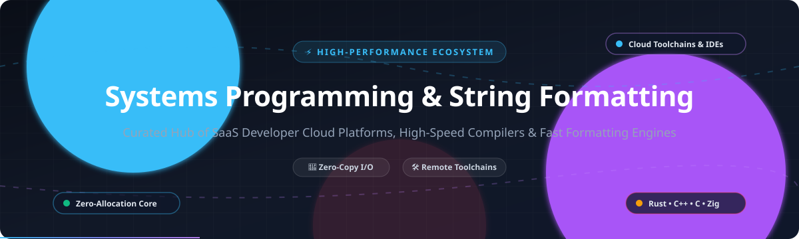

# Awesome Systems Programming & String Formatting ⚡

  

  
  
  
  
  
  
  

---

## 🧭 Overview & Introduction

> **A curated showcase of premier SaaS cloud environments, interactive compiler explorers, low-level system toolchains, and ultra-fast zero-allocation string formatting libraries.**

Welcome to the **Awesome Systems Programming & String Formatting** repository! 🚀 This guide covers production-grade developer platforms, cloud development environments (CDEs), compiler sandboxes, code intelligence tools, and ultra-high-performance formatting algorithms across **Rust, C++, C, and Zig**. 

Whether you are building bare-metal microcontrollers with `no_std`, crafting high-throughput distributed network engines, optimizing compiler backends, or eliminating memory allocations from hot loggers, this collection delivers tested tools with concrete performance benchmarks, company valuations, and pricing tiers.

---

## 📊 Sector Overview & Market Dynamics

- **Estimated Market Size**: The global Cloud Development Environment (CDE) and Developer Tooling market was valued at **~$5.4 Billion in 2024** and is projected to surpass **$14.8 Billion by 2031**, progressing at a rapid compound annual growth rate (CAGR) of **~15.5%**. Concurrently, the systems developer tooling and observability sector represents an addressable market exceeding **$28 Billion**.
- **Market Dynamics & Fragmentation**: The developer platforms and hosted toolchain ecosystem is **moderately concentrated** at the top cloud orchestration layer (dominated by hyperscalers and key players like Microsoft GitHub Codespaces, JetBrains, and Replit), yet remains **highly fragmented and diversified** across specialized developer tools, interactive compiler analysis sandboxes (e.g., Godbolt, Rust Playground), code intelligence engines, and community-driven registry ecosystems. Winner-take-most dynamics govern general-purpose cloud IDE hosting, while domain-specific systems tooling and formatting niches thrive on vibrant open standards.

---

## 📑 Table of Contents

- [📊 Sector Overview & Market Dynamics](#-sector-overview--market-dynamics)
- [☁️ SaaS & Hosted Platforms](#️-saas--hosted-platforms)
- [🛠️ Open-Source GitHub Projects](#️-open-source-github-projects)
- [📈 Star History](#-star-history)
- [🤝 Support & Community](#-support--community)
- [🤝 How to Contribute](#-how-to-contribute)
- [⚖️ Disclaimer](#️-disclaimer)

---

## ☁️ SaaS & Hosted Platforms

The following hosted platforms and developer cloud services provide remote compilation, cloud IDEs, language registry infrastructure, and deep code search. Entries are ranked in descending order by **company valuation / market cap / revenue scale**.

| Platform | Company Scale (Valuation / Revenue) | Description | Starting Pricing Tier | Free Tier Limits / Free Trial |
| :--- | :--- | :--- | :--- | :--- |
| **[GitHub Codespaces](https://github.com)** | **~$3.1 Trillion** (Parent: Microsoft Corp / GitHub ~$1B+ ARR) | 🌐 Cloud-powered development environments integrated with GitHub repositories for instant Rust, C, and C++ builds. | **Pay-As-You-Go**: Starts at **$0.18/hour** for 2-core machines + **$0.07/GB-month** for storage | **Personal Free Allowance (Free forever)**: 120 core hours/month (equivalent to 60 clock hours of a 2-core VM) and 15 GB-months of storage on personal accounts. |
| **[JetBrains RustRover](https://jetbrains.com)** | **~$7 Billion valuation** (~$450M+ annual revenue) | 💻 Dedicated commercial IDE by JetBrains offering deep static analysis, profiling, Cargo toolchain integration, and debugging for Rust. | **Commercial License**: Starts at **$69/year** ($5.75/mo equivalent) for individual commercial use / $229/yr for organizations | **Free forever for Non-Commercial Use**: 100% feature-complete for learning, open-source projects, and hobby dev (requires telemetry enabled). 30-day free trial for commercial evaluation. |
| **[Replit Rust](https://replit.com)** | **~$3 Billion valuation** (~$150M+ ARR) | ⚡ Browser-based collaborative cloud IDE providing instant Linux containers preconfigured with Rust, GCC, and Clang toolchains. | **Core Plan**: Starts at **$20/mo** ($18/mo billed annually) | **Starter Plan (Free forever)**: Basic compute resources, daily AI chat allowance, 1 active published app (sleeps after 5 min inactivity; temporary links expire after 30 days unless renewed). |
| **[Sourcegraph](https://sourcegraph.com)** | **~$2.62 Billion valuation** (~$50M+ ARR) | 🔍 Enterprise code intelligence and universal syntax-aware code search platform for navigating massive multi-gigabyte systems codebases. | **Enterprise Plan**: Starts at **$16,000/year** (~$1,333/month baseline annual contract) | **30-Day Free Trial**: 30-day enterprise evaluation trial available for engineering teams with Cody AI and universal search (no permanent free tier). |
| **[Gitpod](https://gitpod.io)** | **~$150 Million valuation** (~$38M total funding) | 🚀 Automated, ephemeral Cloud Development Environments (CDEs) tailored for containerized Rust, Zig, and C++ repositories. | **Pay-As-You-Go / Paid Add-ons**: Starts at **$9/mo** (expanding credit buckets) | **Free Plan (Free forever)**: Up to 50 hours/month (500 credits/mo) on standard workspace classes with 1-hour timeout and up to 4 concurrent workspaces. |
| **[Codeanywhere](https://codeanywhere.com)** | **~$20 Million valuation** (Acquired / Ceased ops 2026) | 📦 Cloud-hosted IDE and container workspace provider supporting prebuilt Rust and systems programming stacks *(Shut down July 1, 2026)*. | **Basic Plan**: Historically started at **$12/mo** ($9.60/mo billed annually) | **Free Trial / Legacy Free Plan**: Historically offered a 14-day free trial or 20 hours/month free cap before permanently winding down on July 1, 2026. |
| **[Crates.io](https://crates.io)** | **Non-Profit / Foundation-Backed** (Rust Foundation ~$5M annual budget) | 📦 The official community package registry for Rust, distributing formatting libraries, drivers, and runtime crates globally. | **Free** ($0 forever; supported by AWS, Google, Microsoft, and the Rust Foundation) | **Free forever**: Unlimited crate downloads and hosting; enforced limit of max 10 MB compressed archive size per crate, API burst of 5 new crates (1 per 10 min thereafter), and 1 API req/sec. |
| **[Compiler Explorer (Godbolt)](https://godbolt.org)** | **Community-Funded Open SaaS** (~$42k/yr Patreon & Corporate Sponsors) | 🔬 Interactive hosted compiler analysis platform for inspecting assembly output, optimization passes, and execution across dozens of compilers. | **Free** ($0 forever; funded via Patreon, GitHub Sponsors, Intel, and Google) | **Free forever**: Unrestricted access to all compilers, target architectures (x86, ARM, RISC-V, WebAssembly), execution engines, and diffing tools. |
| **[Rust Playground](https://rust-lang.org)** | **Community-Funded Open SaaS** (Maintained by the official Rust Project) | 🦀 Official web sandbox for compiling, running, and sharing Rust code snippets directly in any modern browser. | **Free** ($0 forever; supported by the Rust Project & community infrastructure) | **Free forever**: Full access to Stable, Beta, and Nightly channels with top crates; sandboxed to ~512–640 MB RAM, 10–15s CPU execution timeout, and disabled network access. |

---

## 🛠️ Open-Source GitHub Projects

Explore the most powerful open-source repositories for remote development, systems programming, and zero-overhead string formatting. Projects are ranked in descending order by **GitHub Star Count ⭐**.

| Repository & Stars Badge | Language / Focus | Description | Key Systems Architecture Features |
| :--- | :--- | :--- | :--- |
| **[rust-lang/rust](https://github.com/rust-lang/rust)**  | **Rust** (Core Language) | Empowering everyone to build reliable and efficient software with memory safety without garbage collection. | Core language repository powering `core::fmt`, borrow checker, LLVM backend, and systems standard library. |
| **[coder/code-server](https://github.com/coder/code-server)**  | **TypeScript / Go** | Run VS Code on any remote Linux server and access it directly in any browser window. | Full remote execution, persistent Docker/SSH sessions, and zero local overhead for heavy C++/Rust toolchains. |
| **[BurntSushi/ripgrep](https://github.com/BurntSushi/ripgrep)**  | **Rust** (Search / Text) | An ultra-fast line-oriented search tool that recursively searches current directories for regex patterns. | Exemplar systems architecture combining zero-copy streaming, SIMD regex matching, and memory-mapped file traversal. |
| **[ziglang/zig](https://github.com/ziglang/zig)**  | **Zig / C++** | General-purpose programming language and toolchain designed for robustness, optimality, and maintainability. | Features `std.fmt` with compile-time verified formatting, zero hidden control flow, and zero heap allocations. |
| **[llvm/llvm-project](https://github.com/llvm/llvm-project)**  | **C++ / TableGen** | The LLVM Project compiler and toolchain collection (Clang, LLDB, LLD, libc++, MLIR). | Industry-standard compiler infrastructure providing modern `std::format` implementations in `libc++` and code gen. |
| **[nothings/stb](https://github.com/nothings/stb)**  | **C / C++** | Single-file public domain libraries for C/C++, including the renowned `stb_sprintf.h`. | Locale-independent, fast, lightweight formatting without runtime standard library bloat, ideal for games and embedded. |
| **[facebook/folly](https://github.com/facebook/folly)**  | **C++** | An open-source library of C++17/20 components designed with practicality, performance, and scale in mind. | High-throughput systems routines including `folly::format`, `fbstring`, and zero-allocation IO buffering utilities. |
| **[sharkdp/hyperfine](https://github.com/sharkdp/hyperfine)**  | **Rust** (Benchmarking) | A command-line benchmarking tool providing statistical analysis, warm-up caching, and CLI comparisons. | Indispensable tool for measuring string formatting latency, compiler throughput, and microbenchmarks. |
| **[fmtlib/fmt](https://github.com/fmtlib/fmt)**  | **C++** (String Formatting) | Open-source formatting library providing a fast and safe alternative to C `printf` and C++ `iostreams`. | Foundation for C++20 `std::format`, compile-time string format checking, positional parameters, and zero-allocation sinks. |
| **[eclipse-theia/theia](https://github.com/eclipse-theia/theia)**  | **TypeScript** (Cloud IDE) | An extensible platform for building customized cloud and desktop developer environments and IDEs. | Vendor-neutral framework powering custom aerospace, automotive, and systems IDE workbenches. |
| **[compiler-explorer/compiler-explorer](https://github.com/compiler-explorer/compiler-explorer)**  | **JavaScript / Node.js** | The complete open-source codebase powering Godbolt, enabling local and air-gapped assembly inspection. | Multi-compiler assembly inspection, execution sandboxing, demangling, and AST/IR diff inspection across 50+ languages. |
| **[coder/coder](https://github.com/coder/coder)**  | **Go** (Remote Dev) | Self-hosted remote development platform provisioning Terraform-backed dev environments on any cloud or bare metal. | Provisions isolated Kubernetes, Docker, or VM workspaces tailored for heavy systems build clusters. |
| **[rust-lang/rust-analyzer](https://github.com/rust-lang/rust-analyzer)**  | **Rust** (Compiler LSP) | High-performance modular compiler front-end and Language Server Protocol (LSP) implementation for Rust. | Powers real-time semantic analysis, format macro expansion (`format!`, `println!`), and code intelligence. |
| **[loft-sh/devpod](https://github.com/loft-sh/devpod)**  | **Go / Rust** (CDE) | Client-only developer environment orchestrator using `devcontainer.json` on any cloud, VM, or local Docker. | Eliminates vendor lock-in by converting any Linux machine into an instant containerized systems workstation. |
| **[rust-lang/rustup](https://github.com/rust-lang/rustup)**  | **Rust** (Toolchain Installer) | The official Rust toolchain manager for cross-compiling, managing toolchains, and installing components. | Manages target architectures (ARM, RISC-V, WASM, bare-metal `thumbv*`), sysroots, and nightly toolchains. |
| **[gitpod-io/openvscode-server](https://github.com/gitpod-io/openvscode-server)**  | **TypeScript** | Cloud server distribution enabling upstream Visual Studio Code to be accessed over any modern web browser. | Provides browser-based systems engineering with native support for `rust-analyzer`, `clangd`, and CMake tools. |
| **[judge0/judge0](https://github.com/judge0/judge0)** [?style=social&color=white)](https://github.com/judge0/judge0/stargazers) | **Ruby / C** | Robust, scalable open-source online code execution system and sandboxing engine. | Isolate and execute untrusted C, C++, Rust, and Zig programs with strict CPU, memory, and I/O cgroup limits. |
| **[livegrep/livegrep](https://github.com/livegrep/livegrep)**  | **C++ / Go** | Interactive regex code search engine designed for navigating gigabytes of source code in milliseconds. | Uses re2 regex parsing and memory-mapped inverted indices for instant exploration of massive C/C++ repositories. |
| **[fastfloat/fast_float](https://github.com/fastfloat/fast_float)**  | **C++** (Number Conversion) | Fast and exact implementation of C++ `from_chars` functions for `float` and `double` types. | Processes numbers at over 1 GB/s per core, providing exact round-trip floating point parsing without heap allocations. |
| **[sourcegraph/zoekt](https://github.com/sourcegraph/zoekt)**  | **Go** (Code Search) | Fast trigram-based open-source code search engine powering enterprise search at Sourcegraph. | Creates compact disk indices and performs parallel regex and literal scans across millions of source lines. |
| **[rust-lang/rust-playground](https://github.com/rust-lang/rust-playground)**  | **Rust** (Docker Web UI) | Backend and frontend source code for the official Docker-based online Rust Playground web application. | Demonstrates container sandboxing, compilation isolation, and REST APIs for remote code compilation. |
| **[BurntSushi/bstr](https://github.com/BurntSushi/bstr)**  | **Rust** (Byte Strings) | Byte string library for Rust providing conventional string operations on raw `&[u8]` byte slices. | Enables zero-allocation parsing, SIMD substring searches, and UTF-8 handling on raw byte streams and sockets. |
| **[kellnr/kellnr](https://github.com/kellnr/kellnr)**  | **Rust** (Private Registry) | Private open-source Cargo crate registry with crates.io mirroring and proxy capabilities. | Host proprietary systems packages and caches crates.io dependencies for air-gapped or corporate build networks. |
| **[charlesnicholson/nanoprintf](https://github.com/charlesnicholson/nanoprintf)**  | **C / C++** (Embedded) | Tiny, zero-allocation, highly configurable `snprintf` implementation designed for resource-constrained systems. | Footprint can be tuned under 1 KB of flash storage; zero dynamic heap allocations; ideal for Cortex-M and RTOS kernels. |
| **[dtolnay/ryu](https://github.com/dtolnay/ryu)**  | **Rust** (Float Formatting) | Pure Rust implementation of the Ryū algorithm for fast, shortest-representation floating-point to string printing. | Outperforms standard library float printers by ~3-5x; completely allocation-free with stack buffers. |
| **[japaric/ufmt](https://github.com/japaric/ufmt)**  | **Rust** (Embedded `no_std`) | Faster, smaller, and panic-free alternative to `core::fmt` optimized for microcontrollers and embedded firmware. | Drastically reduces flash bloat (by up to 90%) by avoiding panic-formatting machinery and string formatting tables. |
| **[dtolnay/itoa](https://github.com/dtolnay/itoa)**  | **Rust** (Integer Formatting) | Ultra-fast integer-to-string formatting library printing numbers into unallocated stack buffers. | Generates compact assembly without bounds checks or allocations; fundamental building block in Serde and logging crates. |
| **[Alexhuszagh/rust-lexical](https://github.com/Alexhuszagh/rust-lexical)**  | **Rust** (Lexical Parsing) | High-performance, `no_std`-compatible lexical number-to-string and string-to-number conversion routines. | Supports arbitrary radix conversion, locale handling, and SIMD floating-point conversions. |
| **[rodrimati1992/const_format_crates](https://github.com/rodrimati1992/const_format_crates)**  | **Rust** (Compile-Time) | Rust crate enabling compile-time string formatting and concatenation in `const fn` contexts without runtime overhead. | Generates statically evaluated strings during compilation, eliminating runtime string construction completely. |

---

## 📈 Star History

---

## 🤝 Support & Community

If you find this ecosystem directory helpful for your systems programming journey, benchmarking, or production deployments, please consider supporting the project:

- ⭐ **Star this repository** on GitHub to help other engineers discover these resources!
- 🍴 **Fork the project** and submit additions or improvements for your favorite libraries.
- 📣 **Share with peers** across Reddit (`r/rust`, `r/cpp`), Hacker News, Twitter/X, and technical forums.
- ☕ **Buy a Coffee & Sponsor**: Support ongoing maintenance, automated curation, and open-source contributions directly via the [GitHub Sponsors Dashboard](https://github.com/sponsors/ishandutta2007)!

---

## 🤝 How to Contribute

Contributions are warmly welcomed! Help keep this directory current, accurate, and comprehensive:

1. 🍴 **Fork the repository** on GitHub.
2. 📝 **Create a branch** for your updates (`git checkout -b feature/add-new-tool`).
3. ✏️ **Add/edit entries** in `README.md` following the tabular format (include link, company scale/valuation or star count badge, starting price, and specific limits).
4. 🧪 **Verify all links and data** before submitting.
5. 🚀 **Submit a Pull Request** with a concise explanation of why the tool benefits the systems programming and string formatting community.

---

## ⚖️ Disclaimer

- This repository is a **community-curated index** created for educational, benchmarking, and architectural research purposes — not a commercial endorsement.
- All company valuations, market capitalization numbers, and pricing tiers represent publicly available data, investor reports, and enterprise estimates as of late 2024–2026.
- Always perform comprehensive memory profiling, assembly inspections, and benchmark tests on your exact target hardware architecture (`no_std`, CPU cache hierarchy, stack depth, and instruction set) before committing to a production string formatting or serialization engine.

---

  <b>Built with ⚡ for systems programmers, compiler engineers, embedded hackers, and open-source builders.</b> 
  Let's engineer faster, safer, and zero-allocation software together.

